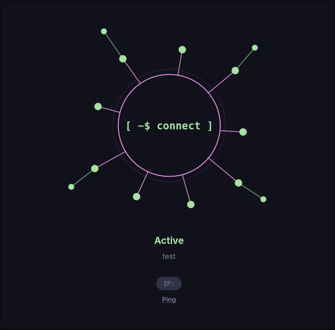
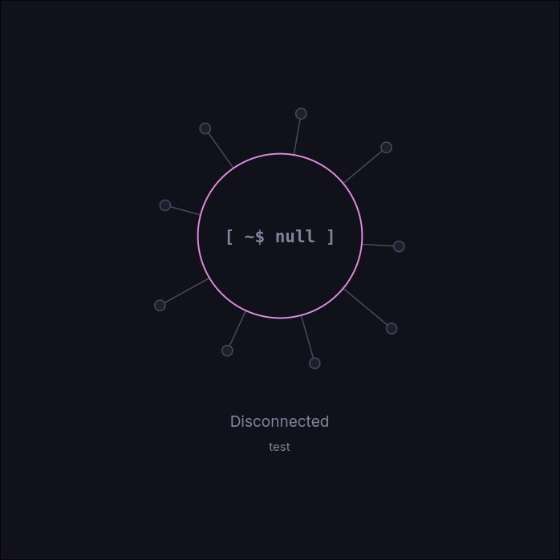
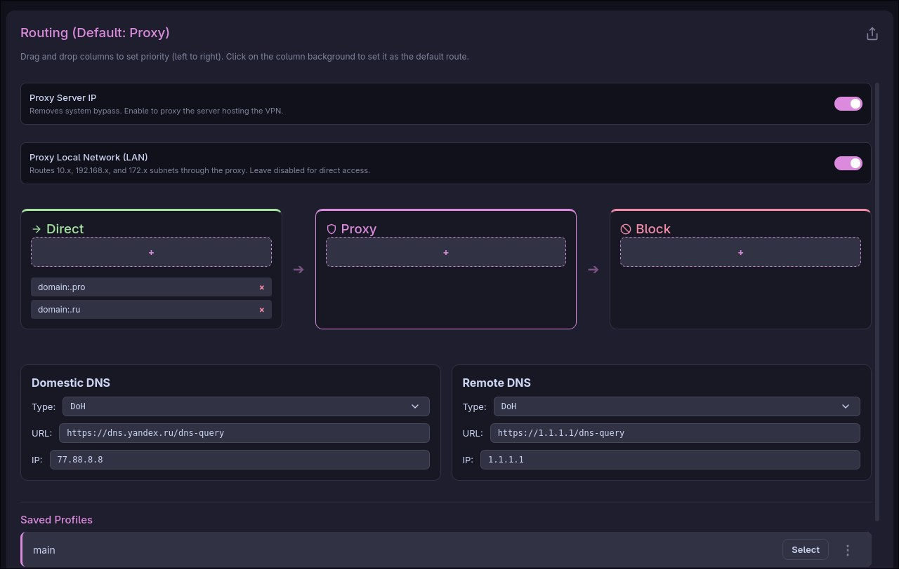
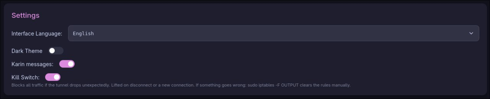

<div align="center">

<h1>KarinCore</h1>
<p><strong>Современный, эстетичный и безопасный прокси-клиент для Linux</strong></p>
<p><a href="https://karincore.ru">Сайт</a> · <a href="https://github.com/detestern/KarinCore/releases">Релизы</a> · <a href="#karincore-на-android-альфа">Android</a> · <a href="https://github.com/detestern/KarinCore/issues">Issues</a></p>
<p><a href="README.md">🇬🇧 English</a> | <a href="README-ru.md">🇷🇺 Русский</a></p>

<p>


</p>
<p><a href="https://karincore.ru"></a></p>
</div>

> 🌐 **Всё в одном месте: [karincore.ru](https://karincore.ru)**
> Пошаговые инструкции по установке для Arch, Debian/Ubuntu и Steam Deck, загрузки, Android-альфа и живое демо маршрутизации: введи домен и посмотри, пойдёт он через Proxy, Direct или Block. Сайт на русском и английском.

<br/>

## Философия проекта

Интернет должен быть свободным, а инструменты для его защиты не должны превращаться в ежедневный ритуал.

KarinCore создана, чтобы избавить пользователей Linux от ручной правки JSON-конфигов, борьбы с `iptables` и постоянного присмотра за systemd-юнитами ради банально работающего туннеля. Это мост между по-настоящему мощным ядром обхода блокировок (Xray, OpenVPN, WireGuard) и интерфейсом, который уважает твоё время и не режет глаза.

Никакого Electron. Никаких песочниц, ломающих маршрутизацию. Только ядро на Rust, нативная интеграция с `systemd` и интерфейс, спроектированный именно под эту программу, а не общий шаблон с прикрученным прокси-клиентом.

<div align="center">

[Возможности](#возможности) · [Скриншоты](#скриншоты) · [Установка](#установка) · [Steam Deck](#karincore-на-steam-deck) · [Android](#karincore-на-android-альфа) · [Архитектура](#архитектура) · [Релизы](#последние-релизы) · [Планы](#вектор-развития) · [Поддержка](#поддержка-контрибьютинг-и-обратная-связь)

</div>

<br/>

## Возможности

**Многоуровневая маршрутизация.** Нативная интеграция OpenVPN и WireGuard рядом с Xray. Заворачивай VLESS/VMess-трафик внутрь зашифрованного OVPN- или WireGuard-туннеля через policy-based роутинг либо гоняй Xray напрямую. Выбор за тобой.

**Визуальный приоритет маршрутизации.** Перетаскивай колонки (Proxy, Direct, Block), чтобы задать точный порядок, в котором Xray применяет правила. Никакой ручной правки JSON-массивов правил.

**Подписки и профили.** Добавляй URL подписки или отдельную ссылку `vless://`, `vmess://`, `trojan://`, `ss://`, `wg://`, либо закидывай `.ovpn` и `.conf` файлы. Правила маршрутизации из подписки тоже импортируются. Сохраняй целые связки (правила, порядок колонок, DNS) в именованные профили.

**Пинг всех серверов.** Одна кнопка в панели серверов измеряет отклик всего списка и подсвечивает его: зелёный до 250 мс, жёлтый до 500 мс, красный выше.

**Страж туннеля.** KarinCore регулярно проверяет, что туннель жив. Если 3 проверки подряд не прошли, VPN отключается, переключается на выбранный сервер или на лучший по пингу.

**Свежие подписки.** Они обновляются при запуске приложения или все сразу одной кнопкой рядом с «Пинг».

**Сценарии подключений.** Правила вроде «если Wi‑Fi *Дом* → выключить VPN» переключают VPN по сети.

**Диагностика.** Отдельная вкладка отвечает на вопрос «почему не работает?»: интернет, DNS, порт сервера и запрос через туннель, с понятным вердиктом и подсказкой, что делать.

**Настоящий Kill Switch.** Блокировка на уровне firewall: если туннель неожиданно пропал, исходящий трафик останавливается, а правила переживают перезапуск демона.

**IPv6 и DNS.** Туннель несёт IPv4 и IPv6 вместе. Независимые Domestic и Remote DNS-резолверы с поддержкой DoH/DoU и один тумблер для проксирования IP самого VPN-сервера.

**Узкая граница привилегий.** Интерфейс никогда не запускается от root. Всё привилегированное идёт через единственный helper с правами root, который проверяет каждый запрос. Подробнее в разделе [«Архитектура»](#архитектура).

**Shell Bridge.** Файл статуса и флаги `--connect` / `--disconnect` позволяют внешним панелям и оболочкам (karin-shell, Brain Shell) показывать соединение и управлять им. Подробности в [истории версий](CHANGELOG-ru.md#v140--shell-bridge).

**Карин.** Встроенная терминальная помощница комментирует, что происходит с ядром: статус соединения, проверки DNS, изредка сухая шутка про твоего провайдера. Отключается в настройках, если хочется тишины.

**Нулевая телеметрия.** Всё работает локально. Ни трекеров, ни аналитики, ни отправки данных куда-либо. Твои ключи, IP-адреса и профили маршрутизации никогда не покидают устройство. Лицензия MIT, исходники полностью открыты.

<br/>

## Скриншоты

<div align="center">


<br/>


</div>

<br/>

## Установка

### Arch Linux (AUR)

Рекомендуемый способ для Arch-based систем (Manjaro, EndeavourOS и другие). Соберёт ядро, подтянет зависимости и настроит системные службы автоматически.

```bash
yay -S karincore-git
```

### Ubuntu / Debian / Linux Mint

Свежий `.deb` всегда доступен в разделе [Releases](https://github.com/detestern/KarinCore/releases). Он устанавливает привилегированный helper, правило `sudoers` из одной строки и юнит `systemd`, создаёт группу `karincore` и добавляет в неё устанавливающего пользователя (после установки перезайди в сессию). Убедись, что в системе уже стоят `openvpn` и `wireguard-tools`. Xray в `.deb` не входит: установи его отдельно (например, через [XTLS/Xray-install](https://github.com/XTLS/Xray-install)). Бинарник должен лежать в `/usr/bin/xray`; если установщик кладёт его в `/usr/local/bin/xray`, пакет сам создаст ссылку.

```bash
sudo dpkg -i KarinCore_1.7.0_amd64.deb
sudo apt install -f # только если не хватает зависимостей
```

### Первый запуск

Демон **не должен** быть в автозагрузке: иначе он начнёт маршрутизировать трафик ещё до того, как интерфейс сформирует рабочий конфиг. Не запускай для него `systemctl enable`. Просто открой KarinCore из меню приложений: интерфейс сам запустит, отследит и остановит демона.

<br/>

## KarinCore на Steam Deck

**KarinCore прекрасно работает на Steam Deck.** SteamOS под капотом — это Arch Linux, поэтому тот же самый AUR-пакет, что и на обычном Linux-десктопе, ставится на Deck без каких-либо особых танцев: полноценный GUI, drag-and-drop маршрутизация, killswitch — всё как есть. Если искал нормальный VPN-клиент для Steam Deck вместо ручной правки конфигов WireGuard через SSH — это оно.

### Перед началом: задай пароль

У аккаунта `deck` по умолчанию обычно **нет пароля** — для игрового режима это не мешает, но `sudo` (который нужен установщику) требует, чтобы пароль вообще существовал. Задай его один раз, в Desktop Mode:

```bash
passwd
```

Следуй подсказкам, дальше — по шагам ниже.

### Переключиться в Desktop Mode

1. Нажми кнопку **STEAM**.
2. Выбери **Power** (Питание).
3. Выбери **Switch to Desktop**.

На рабочем столе открой терминал (Konsole уже установлен).

### Установка на Deck

```bash
sudo steamos-readonly disable
sudo pacman-key --init
sudo pacman-key --populate archlinux
sudo pacman -S --needed base-devel git
yay -S karincore-git
```

`steamos-readonly disable` снимает защиту от записи с системного раздела — SteamOS по умолчанию доступна только для чтения. Это действует до следующего системного обновления SteamOS, после которого перед переустановкой/обновлением KarinCore команду нужно будет повторить.

### Запуск

KarinCore появится в меню приложений, как обычная десктопная программа. Вставь `vless://`-ссылку (или импортируй `.ovpn`/`.conf`), выбери её в боковой панели и нажми на ядро, чтобы подключиться.

Когда закончишь — вернись в игровой режим прямо с рабочего стола: **Return to Gaming Mode**.

<details>
<summary><b>Возможные проблемы</b></summary>

На некоторых образах SteamOS всплывали ещё две проблемы, которые сам пакет починить не может — это разовые системные фиксы, не связанные с KarinCore напрямую.

**`error: ... signature from "GitLab CI Package Builder ... is unknown trust`** (обычно на этапе установки `base-devel`)

Часть пакетов SteamOS пересобирается и подписывается собственным ключом Valve, который не всегда доверенный на свежей системе. Фикс:

```bash
grep "^SigLevel" /etc/pacman.conf   # запомни текущее значение, чтобы вернуть потом
sudo sed -i 's/^SigLevel.*/SigLevel = TrustAll/' /etc/pacman.conf
sudo pacman -Syy
sudo pacman -S holo-keyring archlinux-keyring
sudo pacman-key --populate archlinux holo
sudo sed -i 's/^SigLevel.*/SigLevel = Required DatabaseOptional/' /etc/pacman.conf
sudo pacman -Scc   # почистить кэш пакетов, не прошедших проверку подписи, дальше Y
```

После этого повтори шаг с `base-devel`/`yay -S karincore-git`.

**`feature 'edition2024' is required` / сборка падает где-то в середине компиляции Rust**

Значит системный пакет `rust` на этом образе SteamOS слишком старый. Поставь актуальный набор через `rustup`:

```bash
sudo pacman -S rustup
rustup default stable
rustc --version   # должна быть свежая версия
```

После этого повтори `yay -S karincore-git`.

**Сборка останавливается с сообщением про отсутствующие заголовки `openssl`, `glibc` или `linux-api-headers`**

Та же природа, что и выше (на некоторых образах SteamOS заголовочные файлы физически вырезаны, хотя в базе pacman пакет числится установленным) — сборка сама выведет точную команду для запуска, что-то вроде:

```bash
sudo pacman -S --overwrite '/usr/include/*' openssl glibc linux-api-headers
```

Выполни ровно то, что укажет сообщение, и повтори `yay -S karincore-git`. (Сборка намеренно останавливается и просит выполнить это самостоятельно, а не делает это сама — `PKGBUILD`, вызывающий `sudo` от своего имени, это тревожный звоночек, к которому стоит относиться с подозрением, поэтому здесь так специально не сделано.)

Если столкнулся с чем-то ещё — заведи issue на GitHub, похоже, образы SteamOS отличаются друг от друга сильнее, чем ожидалось, и знать об этом полезно.

</details>

<br/>

## KarinCore на Android (альфа)

У KarinCore есть и **экспериментальная версия для Android**: тот же интерфейс и модель маршрутизации поверх `VpnService` и Xray-core. Она живёт в [ветке `android`](https://github.com/detestern/KarinCore/tree/android) этого репозитория и развивается независимо от Linux-клиента, со своей нумерацией версий (`0.x.y-alpha.n`).

**Что работает:** ссылки VLESS/Reality, VMess, Trojan и Shadowsocks, подписки с импортом маршрутизации, зоны Direct / Proxy / Block, раздельное туннелирование по приложениям, настройки DNS, вкладка диагностики и виджет на рабочем столе.

**Установка:**
1. Открой [Releases](https://github.com/detestern/KarinCore/releases) и выбери свежий релиз с тегом `android-v…` (они помечены *Pre-release*, а «Latest» остаётся за релизами Linux-версии). Те же APK есть и на [karincore.ru](https://karincore.ru).
2. Скачай APK под свой телефон: `arm64-v8a` подходит почти для всех современных устройств, `armeabi-v7a` для старых 32-битных.
3. Разреши установку из браузера или файлового менеджера, когда Android спросит, и открой APK.

**Важно:** это альфа-сборки, обновления ставятся вручную (на странице «О программе» видно, что вышла новая версия). Считай это тестовой сборкой и сообщай о проблемах в [Issues](https://github.com/detestern/KarinCore/issues). Инструкция по сборке: [README ветки `android`](https://github.com/detestern/KarinCore/blob/android/README-ru.md).

<br/>

## Архитектура

Привилегии разделены между одним непривилегированным приложением и небольшим набором служб с правами root.

**Frontend (`karincore`).** Tauri-интерфейс, целиком работающий в пространстве пользователя. Сам никогда не запускается от root. Привилегированные действия выполняются через единственный helper с правами root (`/usr/libexec/karincore/karincore-helper`), единственную программу, которую группа `karincore` может запускать через `sudo`. Он читает запрос из stdin, проверяет его от root и только потом выполняет операцию.

**Root-часть.** Systemd-служба `karin-proxy-daemon` запускает Xray (или OpenVPN/WireGuard) с сгенерированным конфигом, а `route.sh` поднимает TUN, политику маршрутизации и DNS (`resolvectl`) и возвращает всё обратно при отключении.

Такое разделение означает, что весь графический стек (веб-вью, рендеринг, всё) работает без привилегий. Root получает только та узкая часть, которой он реально нужен.

<br/>

## Последние релизы

| Версия | Название | Что изменилось |
|---|---|---|
| [v1.7.0](CHANGELOG-ru.md#v170--lifeline) | Lifeline | Запасной сервер при обрыве туннеля, обновление подписок при запуске |
| [v1.6.0](CHANGELOG-ru.md#v160--waypoint) | Waypoint | Сценарии подключений: переключение VPN по Wi‑Fi сети |
| [v1.5.5](CHANGELOG-ru.md#v155--afterglow) | Afterglow | Страницы зон на всю ширину, мягкая подсветка при наведении |
| [v1.5.4](CHANGELOG-ru.md#v154--compass) | Compass | Вкладка маршрутизации: карточки приоритета и страницы зон |
| [v1.5.3](CHANGELOG-ru.md#v153--sonar) | Sonar | Пинг всех серверов, панель серверов из двух блоков |
| [v1.5.2](CHANGELOG-ru.md#v152--check-engine) | Check Engine | Вкладка диагностики |
| 1.3.x | — | Режим handheld, укрепление безопасности, импорт маршрутизации из подписки |

Все релизы начиная с 1.0.0, с датами, собраны в **[полной истории версий →](CHANGELOG-ru.md)**

<br/>

## Вектор развития

KarinCore создавалась в первую очередь для Linux, но у свободного интернета нет границ ОС. Нативные порты на **Windows** и **macOS** следующая крупная веха. Дальше: страж туннеля на Android, контекстные профили, статистика трафика по приложениям и зашифрованный перенос настроек.

<br/>

## Благодарности

Отдельное спасибо **Максиму Гуштеру** ([VivaGushter](https://github.com/VivaGushter)) за помощь с тестированием и разработкой Android-версии.

<br/>

## Поддержка, контрибьютинг и обратная связь

Проект создаётся и поддерживается силами одного независимого разработчика. Баг-репорты, пул-реквесты и идеи по UI/UX искренне приветствуются: открой [issue](https://github.com/detestern/KarinCore/issues) или загляни на **[karincore.ru](https://karincore.ru)**.

Если KarinCore помогает тебе оставаться на связи и ты хочешь поддержать разработку, включая грядущие порты на Windows/macOS, можно закинуть донат:

**USDT (TRC20):** `TQCQhGQD6xgaDxwqAVcTiapS6rdcPyf24X`

Если проект оказался полезен, ⭐️ на репозитории будет очень кстати.

<div align="center"><p><a href="README.md">🇬🇧 English</a> | <a href="README-ru.md">🇷🇺 Русский</a></p></div>
